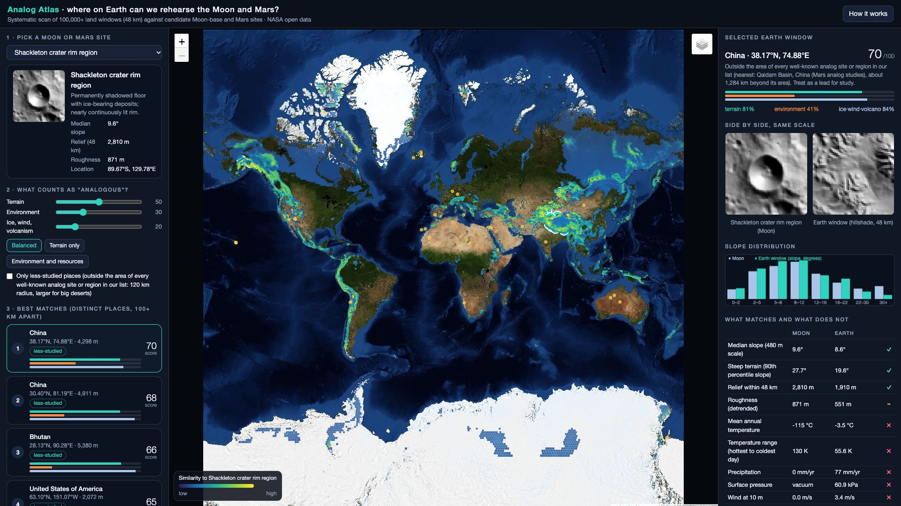

# Analog Atlas

**Where on Earth can we rehearse the Moon and Mars?** A systematic, data-driven search for terrestrial analogs of candidate Moon-base and Mars sites, built on NASA open data.

Team Infinity · NASA Space Apps Challenge 2026 · Challenge: **Identify Earth Locations that Analog the Permanent Moon Base Locations and Mars**



**Live tool:** https://merdanov11.github.io/analog-atlas/atlas/ · **7-slide demo:** [docs/demo/AnalogAtlas_Demo.pdf](docs/demo/AnalogAtlas_Demo.pdf)

## What it does

1. **Pick a Moon or Mars site** (23 candidates: Shackleton, de Gerlache, Faustini, Haworth, Nobile, Mons Malapert, Amundsen, Cabeus, Shoemaker, Peary, Marius Hills; Jezero, Gale, Gusev, Oxia Planum, Meridiani, Mawrth Vallis, Arcadia, Deuteronilus, Utopia, Protonilus, Hellas, Noctis Labyrinthus).
2. **See every place on Earth scored against it.** About 104,000 land windows of 48 km cover the whole Earth between 80°N and 80°S. The map colours each window by similarity.
3. **Decide what "analogous" means.** Three scores, each from 0 to 1, with weights you set: **terrain**, **environment**, **ice, wind and volcanism**. Presets: balanced, terrain only, environment and resources.
4. **Look beyond the usual suspects.** One switch hides every place inside the area of a well-known analog site or region (Atacama, Haughton, Dry Valleys, Iceland, Hawaii and about 40 more; 120 km radius, larger for big deserts), leaving *less-studied* leads.
5. **Understand each result.** A side-by-side hillshade at identical scale, a slope-distribution chart, and a table of what matches (✓), partly matches (~) or differs (✗), with a short note on what the place could be used for. Gravity, vacuum or thin atmosphere, and radiation are always marked as differences.
6. **Take it with you.** Results download as CSV; the URL remembers the chosen site.

## Method in one page

* **Common scale.** Every window, on the Moon, Mars and Earth, is 48 km x 48 km resampled to 100 x 100 cells of 480 m. LOLA (118 m) is block-averaged, MOLA (463 m) is used as it is, and Earth elevation tiles are resampled. Terrain statistics therefore describe the same spatial scale on all three bodies.
* **Terrain score.** Median and 90th-percentile slope, relief (5th to 95th percentile), roughness (height scatter after removing the best-fit plane) and the whole slope histogram, compared with a standardised distance and a Jensen-Shannon term.
* **Environment score.** Annual mean temperature, annual temperature range (hottest to coldest day), precipitation, air pressure (from elevation), wind and UV index from NASA POWER (MERRA-2). Moon and Mars values are rounded literature ranges *clipped to what exists on Earth*, so the score ranks how Moon- or Mars-like a climate tendency is. It never claims a match.
* **Ice, wind, volcanism.** Ground-ice potential (cold ground), aeolian potential (windy and dry) and basaltic volcanic setting (distance to the nearest basaltic Holocene volcano) compared with the target's tags.
* **Total.** Weighted mean of the three scores; weights are yours.
* **Validation.** `analogs/validate.py` checks that well-known analog sites score high for the targets they are used for, and `tests/atlas_parity.py` checks that the browser reproduces the Python scores (difference about 1e-7).

Full formulas: [docs/ARCHITECTURE.md](docs/ARCHITECTURE.md).

## Results

Best *less-studied* places (outside the area of every well-known analog site or region in our list), balanced weights (terrain 0.5, environment 0.3, ice/wind/volcanism 0.2), distinct places at least 100 km apart. Scores are 0 to 100. Explore every site and weighting in the live tool.

| Site | Best less-studied places (score) |
|---|---|
| Shackleton crater rim region (Moon) | China (38.2°N, 74.9°E) 70; China (30.4°N, 81.2°E) 68; Bhutan (28.1°N, 90.3°E) 66 |
| de Gerlache crater (Moon) | China (36.9°N, 84.7°E) 72; China (37.5°N, 87.6°E) 70; China (37.8°N, 74.9°E) 70 |
| Faustini crater (Moon) | China (43.4°N, 84.1°E) 66; India (33.0°N, 79.1°E) 65; China (37.5°N, 87.6°E) 65 |
| Haworth crater (Moon) | China (36.9°N, 84.7°E) 63; China (37.8°N, 74.9°E) 61; India (34.0°N, 77.6°E) 60 |
| Nobile crater (Moon) | China (36.2°N, 80.3°E) 73; China (38.2°N, 74.9°E) 70; China (37.5°N, 87.6°E) 70 |
| Mons Malapert (Moon) | Argentina (32.1°S, 69.9°W) 63; China (36.9°N, 84.7°E) 62; Kazakhstan (43.0°N, 77.0°E) 62 |
| Amundsen crater (Moon) | China (43.0°N, 85.0°E) 73; China (37.2°N, 87.6°E) 71; China (38.5°N, 89.7°E) 71 |
| Cabeus crater (Moon) | China (31.4°N, 80.1°E) 76; China (34.3°N, 80.7°E) 74; China (36.2°N, 80.7°E) 74 |
| Shoemaker crater (Moon) | China (37.8°N, 74.9°E) 59; China (43.4°N, 84.1°E) 59; China (36.9°N, 84.7°E) 59 |
| Peary crater (north pole) (Moon) | China (38.2°N, 97.9°E) 70; China (32.7°N, 93.7°E) 70; China (33.6°N, 93.1°E) 69 |
| Marius Hills (lava-tube skylights) (Moon) | United States of America (34.3°N, 108.9°W) 73; Afghanistan (32.3°N, 68.4°E) 69; United States of America (41.1°N, 105.1°W) 68 |
| Jezero crater (Mars) | China (36.2°N, 87.5°E) 76; China (34.9°N, 82.3°E) 74; China (35.9°N, 85.5°E) 74 |
| Gale crater (Mars) | Argentina (25.6°S, 67.8°W) 67; Chile (21.4°S, 68.3°W) 67; Argentina (31.4°S, 67.9°W) 66 |
| Gusev crater (Mars) | Saudi Arabia (26.2°N, 40.9°E) 68; Libya (23.6°N, 15.9°E) 68; Saudi Arabia (23.6°N, 43.1°E) 68 |
| Oxia Planum (Mars) | China (41.4°N, 95.2°E) 73; Mongolia (44.0°N, 97.0°E) 73; China (41.7°N, 96.5°E) 73 |
| Meridiani Planum (Mars) | China (35.3°N, 85.0°E) 75; China (41.4°N, 96.5°E) 75; China (35.6°N, 83.5°E) 75 |
| Mawrth Vallis (Mars) | Antarctica (73.5°S, 162.3°E) 71; China (36.2°N, 87.1°E) 70; Mongolia (45.0°N, 93.8°E) 70 |
| Arcadia Planitia (Mars) | Antarctica (73.5°S, 90.6°E) 78; Antarctica (78.1°S, 23.4°E) 77; Antarctica (75.1°S, 91.3°E) 77 |
| Deuteronilus Mensae (Mars) | China (37.2°N, 88.0°E) 78; China (35.6°N, 85.5°E) 78; China (36.2°N, 87.5°E) 76 |
| Utopia Planitia (Mars) | Antarctica (79.4°S, 72.5°E) 75; Antarctica (77.1°S, 27.5°E) 75; Antarctica (79.4°S, 98.7°E) 74 |
| Protonilus Mensae (Mars) | China (35.9°N, 85.5°E) 84; China (36.2°N, 87.5°E) 82; China (34.9°N, 82.3°E) 82 |
| Hellas Planitia floor (Mars) | Mongolia (43.4°N, 96.6°E) 73; Mongolia (44.6°N, 95.7°E) 73; Mongolia (44.6°N, 98.9°E) 73 |
| Noctis Labyrinthus (Mars) | China (38.8°N, 88.9°E) 59; China (36.6°N, 80.3°E) 57; Argentina (29.5°S, 69.4°W) 56 |

**Sanity check.** For each target we compared the best score reached inside the area of any well-known analog site or region with all Earth windows:

| Site | Best well-known site (score) | Percentile of that score among all windows | Well-known sites in the top 5% |
|---|---|---|---|
| Shackleton crater rim region | Qaidam Basin, China (Mars analog studies) (55) | 99.8 | 19 of 43 |
| de Gerlache crater | Qaidam Basin, China (Mars analog studies) (65) | 100.0 | 18 of 43 |
| Faustini crater | Ojos del Salado, Chile (58) | 99.9 | 20 of 43 |
| Haworth crater | Qaidam Basin, China (Mars analog studies) (53) | 99.9 | 17 of 43 |
| Nobile crater | Ojos del Salado, Chile (66) | 100.0 | 19 of 43 |
| Mons Malapert | Death Valley (53) | 99.8 | 14 of 43 |
| Amundsen crater | Qaidam Basin, China (Mars analog studies) (74) | 100.0 | 27 of 43 |
| Cabeus crater | Qaidam Basin, China (Mars analog studies) (72) | 100.0 | 25 of 43 |
| Shoemaker crater | Qaidam Basin, China (Mars analog studies) (52) | 100.0 | 18 of 43 |
| Peary crater (north pole) | Qaidam Basin, China (Mars analog studies) (70) | 100.0 | 23 of 43 |
| Marius Hills (lava-tube skylights) | Qaidam Basin, China (Mars analog studies) (73) | 100.0 | 27 of 43 |
| Jezero crater | Qaidam Basin, China (Mars analog studies) (76) | 100.0 | 27 of 43 |
| Gale crater | Atacama, Salar de Atacama (68) | 100.0 | 32 of 43 |
| Gusev crater | Qaidam Basin, China (Mars analog studies) (75) | 100.0 | 16 of 43 |
| Oxia Planum | Qaidam Basin, China (Mars analog studies) (76) | 100.0 | 15 of 43 |
| Meridiani Planum | Qaidam Basin, China (Mars analog studies) (76) | 100.0 | 23 of 43 |
| Mawrth Vallis | Atacama Desert, Yungay (75) | 100.0 | 31 of 43 |
| Arcadia Planitia | Qaidam Basin, China (Mars analog studies) (70) | 99.7 | 10 of 43 |
| Deuteronilus Mensae | Qaidam Basin, China (Mars analog studies) (79) | 100.0 | 25 of 43 |
| Utopia Planitia | Qaidam Basin, China (Mars analog studies) (69) | 99.9 | 11 of 43 |
| Protonilus Mensae | Qaidam Basin, China (Mars analog studies) (80) | 100.0 | 30 of 43 |
| Hellas Planitia floor | Atacama Desert, Yungay (73) | 100.0 | 26 of 43 |
| Noctis Labyrinthus | Death Valley (53) | 100.0 | 25 of 43 |

## Data and resources

| Data | Source | Used for |
|---|---|---|
| Moon elevation, LRO LOLA 118 m | NASA LRO LOLA, USGS Astrogeology | Terrain of Moon targets |
| Mars elevation, MGS MOLA 463 m | NASA MGS MOLA, USGS Astrogeology | Terrain of Mars targets |
| Earth elevation tiles (zoom 8) | NASA SRTM and other open sources, via AWS Terrain Tiles | Terrain of 104,000 Earth windows |
| Climatology: temperature, precipitation, wind, UV index | NASA POWER (MERRA-2), power.larc.nasa.gov | Environment score |
| Satellite imagery | NASA GIBS (Blue Marble, MODIS Terra) | Base maps |
| Holocene volcanoes | Smithsonian Global Volcanism Program | Volcanic setting |
| Feature coordinates | IAU Gazetteer of Planetary Nomenclature (USGS) | Target positions |
| Land and country polygons | Natural Earth (public domain) | Land mask, country labels |

Software: Leaflet 1.9.4 (BSD-2-Clause), NumPy, SciPy, Rasterio, Pillow (BSD-style licences), websockets (BSD-3-Clause).

## Honest limits

* Earth cannot reproduce reduced gravity, lunar vacuum, Martian pressure or the radiation environment. The Atlas never scores these as matches.
* The global score uses terrain, climate and three process proxies. It does **not** include geology, mineralogy, surface materials, biology or caves. Treat results as screening leads for closer study.
* Moon and Mars environment values and the tags (ice, aeolian, volcanic) are rounded literature-based classes entered by hand; they are listed in `analogs/config.py` and should be reviewed by a planetary scientist.
* NASA POWER climate is a 0.5-degree reanalysis: mountain micro-climates are smoothed. Elevation tiles are finest where SRTM exists (about 60°N to 56°S); higher latitudes are coarser.
* The list of well-known analog sites is ours (about 45 entries with approximate coordinates), not an official catalogue.
* Windows are 48 km wide and 36 km apart: a small area inside a window can match better than the window as a whole.

## Reproduce it

Requirements: Python 3.10+, about 12 GB free disk (source DEMs and cached tiles), Google Chrome for screenshots and the PDF.

```bash
python3 -m venv .venv && .venv/bin/pip install -r requirements.txt
mkdir -p data/mars data/moon
curl -L -o data/mars/Mars_MGS_MOLA_DEM_mosaic_global_463m.tif https://planetarymaps.usgs.gov/mosaic/Mars_MGS_MOLA_DEM_mosaic_global_463m.tif
curl -L -o data/moon/Lunar_LRO_LOLA_Global_LDEM_118m_Mar2014.tif https://planetarymaps.usgs.gov/mosaic/Lunar_LRO_LOLA_Global_LDEM_118m_Mar2014.tif
.venv/bin/python -I analogs/targets.py          # Moon and Mars signatures (about 1 minute)
for s in mask power tiles scan volc; do .venv/bin/python -I analogs/earth.py $s; done   # Earth scan (about 1-2 hours, mostly downloads)
.venv/bin/python -I analogs/export.py            # writes docs/atlas/data/
.venv/bin/python -I analogs/validate.py
.venv/bin/python tests/atlas_parity.py
python3 -m http.server 8000 --directory docs/atlas   # open http://localhost:8000
```

The exported dataset (`docs/atlas/data/`, about 7 MB) is committed, so the tool works without any of these steps.

## Project layout

```
analogs/   pipeline: config, common, targets, earth (mask, power, tiles, scan, volc), score, export, validate
docs/atlas/        the web tool (static; runs on GitHub Pages) and its dataset
docs/demo/         7-slide demo (HTML and PDF)
docs/SUBMISSION.md texts for the NASA Space Apps project page
tests/             atlas_parity.py
tools/             atlas_shots.py (screenshots), build_demo.py (PDF), cdp.py
```

## The whole project: Far from Earth + Analog Atlas

This repository holds both tools of Team Infinity, connected by buttons:

* **Far from Earth** (`server/`, `web/`): a layered Moon/Mars map with route planning for an astronaut on foot, a crewed rover, a robotic rover and a drone, plus a physics-based driving and walking simulator on the same NASA terrain, a drone, a shared multiplayer world and live NASA/JPL rover positions. Details: [README_ROUTES.md](README_ROUTES.md) and [docs/routes_beyond_earth/](docs/routes_beyond_earth/).
* **Analog Atlas** (`analogs/`, `docs/atlas/`): the entry for the challenge "Identify Earth Locations that Analog the Permanent Moon Base Locations and Mars". It also ships inside the map (`web/atlas/`): the map has an "Earth analogs of this site" button, and the Atlas has a "Route planner and simulator" button.

Run everything together (needs the source DEMs and the routing grids, see README_ROUTES.md for the data steps):

```bash
.venv/bin/uvicorn app:app --app-dir server --host 0.0.0.0 --port 8000
# map and simulator: http://127.0.0.1:8000/    Atlas inside it: http://127.0.0.1:8000/atlas/
```

The Atlas alone needs no server and no large data: open the live page or run `python3 -m http.server 8000 --directory docs/atlas`.

## Use of Super Intelligence (SI / AI) tools

Large parts of the code and documentation of both tools were written with an AI coding assistant, including the design of the Atlas method. See [docs/SI_DISCLOSURE.md](docs/SI_DISCLOSURE.md) (Analog Atlas) and [SI_DISCLOSURE.md](SI_DISCLOSURE.md) (Far from Earth).

## Licence

Original code and documents: **Apache License 2.0** ([LICENSE](LICENSE)). Third-party data keeps its own terms: NASA and USGS data are open; Natural Earth is public domain; Smithsonian GVP data are used with attribution; AWS Terrain Tiles are open data.

## References

* Smith, D. E., et al. (2001). Mars Orbiter Laser Altimeter: Experiment summary after the first year of global mapping of Mars. *J. Geophys. Res.*, 106(E10), 23689-23722.
* Smith, D. E., et al. (2010). The Lunar Orbiter Laser Altimeter investigation on the Lunar Reconnaissance Orbiter mission. *Space Sci. Rev.*, 150, 209-241.
* Farr, T. G., et al. (2007). The Shuttle Radar Topography Mission. *Reviews of Geophysics*, 45, RG2004.
* Gelaro, R., et al. (2017). The Modern-Era Retrospective Analysis for Research and Applications, Version 2 (MERRA-2). *J. Climate*, 30, 5419-5454.
* Global Volcanism Program (2024). Volcanoes of the World. Smithsonian Institution.
* Lin, J. (1991). Divergence measures based on the Shannon entropy. *IEEE Trans. Inf. Theory*, 37, 145-151.
