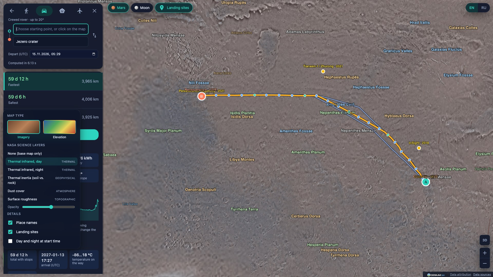
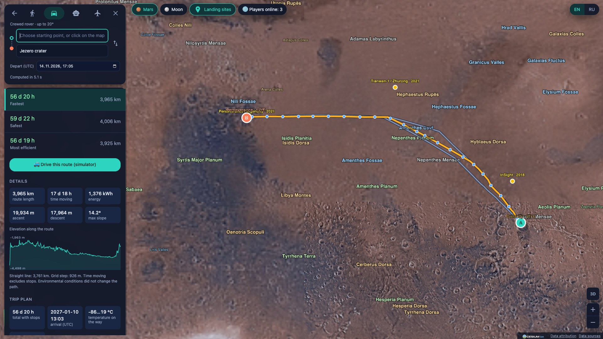
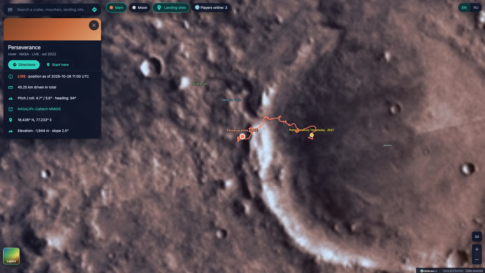
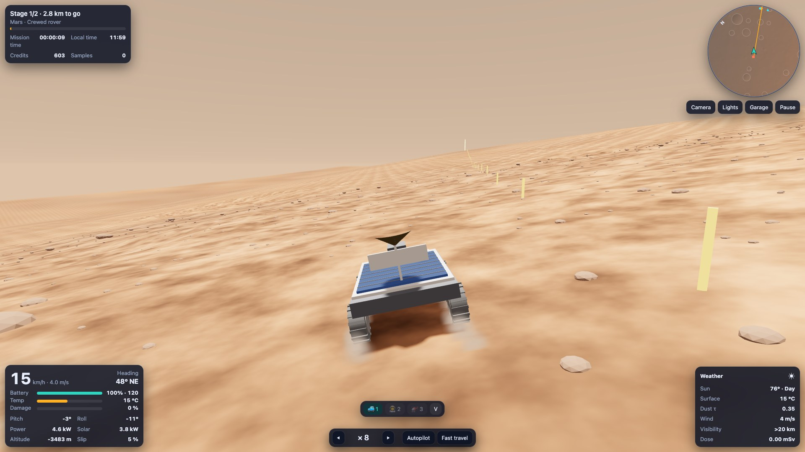
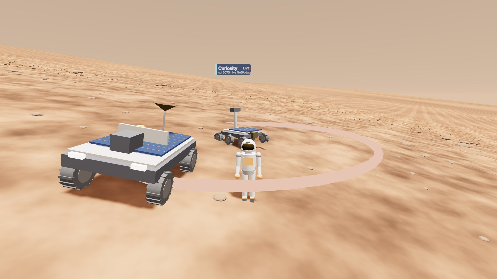
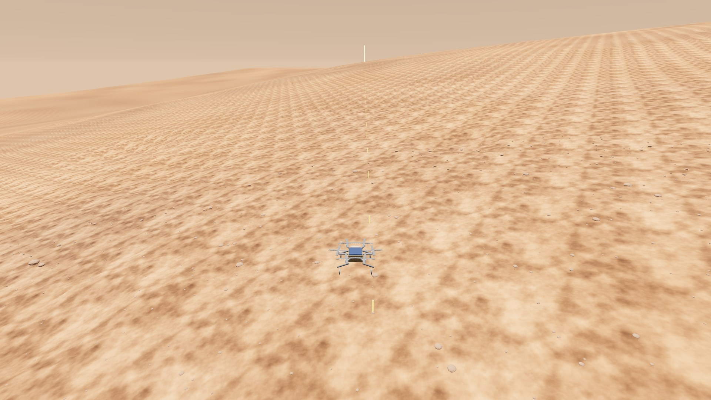
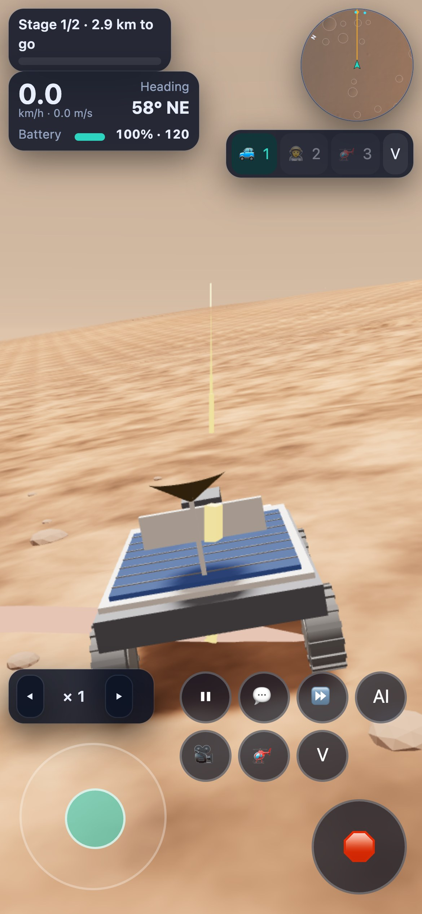

# Routes Beyond Earth

**A layered navigator, a physics-based driving simulator and a shared world for Mars (and the Moon), built on NASA open data.**

Team Infinity · NASA Space Apps Challenge 2026 · Challenge: **Interplanetary Survival Guide: Martian Map**



## What it does

1. **Plan.** Click two points on a layered map of Mars (or the Moon). The server computes three routes at once (fastest, safest, most efficient) for four kinds of traveller: an astronaut on foot, a crewed rover, a robotic rover and a drone. Each traveller has its own slope limit, speed, shift length and power budget. Identical alternatives are merged into one card.
2. **Layer.** The map combines several kinds of NASA data: optical (Viking MDIM mosaic, TES albedo), topographic (MOLA elevation, hillshade, roughness), thermal (THEMIS day/night infrared), geophysical (TES thermal inertia), atmospheric (TES dust cover) and spectral (TES pyroxene mineralogy). Layers can be blended with an opacity slider.
3. **Brief.** Every route comes with a trip plan: distance, time moving, energy, ascent/descent, steepest slope, elevation profile, temperature range, radiation dose estimate, dust-storm risk, daylight shifts and rests.
4. **Drive it.** One button opens a Three.js simulator on the same terrain: raycast wheels with soil sinkage and thrust, suspension, battery, heat, solar power and dust. The astronaut can leave the rover, walk (third-person view with a stride-matched walk cycle), call a drone and switch control between them.
5. **Share.** A small WebSocket server (10 Hz) puts several people into the same world: chat, map pings, energy sharing and collisions. Live positions of the real Perseverance and Curiosity rovers come from NASA/JPL's MMGIS service.
6. **Everywhere.** The simulator has a touch interface (joystick, buttons, pinch) and a lighter render mode for phones.

| Plan and compare | Real vehicles, live | Drive on real terrain |
|---|---|---|
|  |  |  |

| Astronaut, rover and the real Curiosity | Mars drone | Phone |
|---|---|---|
|  |  |  |

## How it addresses the challenge

The challenge asks for a layered, integrated view of a location or route on Mars that pulls together data from several NASA missions and helps a human explorer plan a Marswalk. Our answer:

* **At least three kinds of NASA data on one map:** optical, topographic, thermal, geophysical, atmospheric, spectral (see above), plus live rover positions.
* **A route map for a person in a spacesuit:** the "on foot" profile (25° maximum slope, 3 km/h, 7-hour daylight shifts) avoids steep terrain; the simulator's local planner avoids boulders.
* **Safety information:** temperature range, radiation dose estimate, dust-storm risk and daylight windows along the route.
* **Point-of-view preview:** the simulator shows what the route feels like from the ground, so the explorer knows what to expect.
* **Rovers and drones to carry people and tools:** crewed rover, robotic rover and drone profiles, and a multi-player world for working in pairs or teams.

## NASA data and resources used

| Data | Source | Used for |
|---|---|---|
| Mars elevation, MGS MOLA DEM 463 m | NASA MGS MOLA, USGS Astrogeology | Route planning grid, slope, simulator terrain |
| Moon elevation, LRO LOLA DEM 118 m | NASA LRO LOLA, USGS Astrogeology | Same, for the Moon |
| Viking MDIM 2.1 color mosaic, MOLA color hillshade, LRO WAC mosaic, LOLA shaded relief | NASA/JPL Solar System Treks (trek.nasa.gov) | Base maps, planet textures in the presentation |
| THEMIS day and night infrared mosaics (100 m) | Mars Odyssey THEMIS via Mars Trek | Thermal layers |
| TES thermal inertia, dust cover, albedo, pyroxene abundance; MOLA surface roughness | Mars Global Surveyor via Mars Trek | Geophysical, atmospheric, optical, spectral, topographic layers |
| Perseverance and Curiosity waypoints (position, sol, distance) | NASA/JPL-Caltech MMGIS (mars.nasa.gov/mmgis-maps), cached for 10 minutes | Live vehicles on the map and in the simulator |
| Landing sites | NASA NSSDCA and agency mission reports | Landmarks |
| Place names | IAU Gazetteer of Planetary Nomenclature (USGS Astrogeology) | Search and labels |

**Models built on published NASA measurements** (they are models, not raw data layers): Sun position (Allison & McEwen, 2000; Meeus, 1998), lunar surface temperature (Williams et al., 2017, Diviner), Martian surface radiation (Hassler et al., 2014, MSL/RAD), dust-storm probability and optical depth (simplified), soil mechanics (Bekker, 1969; Janosi & Hanamoto, 1961; Wong, 2008), crater size statistics (Neukum et al., 2001).

## Honest limits

* Routes are computed on a 926 m (Mars) / 474 m (Moon) grid. Below the native DEM resolution (463 m / 118 m) the simulator adds a statistical model of craters and rocks: it is plausible, not surveyed.
* Temperature, radiation and storm figures are simplified educational models, not mission-grade predictions.
* Live positions update after each rover drive (NASA publishes waypoints, not a continuous feed). We found no open feed for lunar vehicles or Ingenuity, so those show only the last known landing site.
* The Moon rocket hopper is a concept, not a flight design.

## Run it

Requirements: Python 3.10+, Node.js (only for the physics tests), about 11 GB of free disk for the source DEMs and about 2 GB for derived grids.

```bash
python3 -m venv .venv
.venv/bin/pip install -r requirements.txt

# 1. Download the two public elevation maps (about 2.1 GB and 8.5 GB)
mkdir -p data/mars data/moon
curl -L -o data/mars/Mars_MGS_MOLA_DEM_mosaic_global_463m.tif https://planetarymaps.usgs.gov/mosaic/Mars_MGS_MOLA_DEM_mosaic_global_463m.tif
curl -L -o data/moon/Lunar_LRO_LOLA_Global_LDEM_118m_Mar2014.tif https://planetarymaps.usgs.gov/mosaic/Lunar_LRO_LOLA_Global_LDEM_118m_Mar2014.tif

# 2. Build the routing grids (a few minutes each)
.venv/bin/python -I server/prep.py mars
.venv/bin/python -I server/prep.py moon

# 3. Start the server (0.0.0.0 lets other devices on the same network join the shared world)
.venv/bin/uvicorn app:app --app-dir server --host 0.0.0.0 --port 8000
```

Then open <http://127.0.0.1:8000/> (map), press **Drive this route** after planning a route (simulator), and <http://127.0.0.1:8000/presentation> for the talk deck. The map needs internet access for NASA Trek tiles, CesiumJS and three.js (loaded from cdnjs).

Place names are shipped in `data/places/*.json` (derived from the IAU gazetteer). To rebuild them, download `MARS_nomenclature_center_pts.zip` and `MOON_nomenclature_center_pts.zip` from the USGS Planetary Names site into `data/names/mars/` and `data/names/moon/`, then run `server/prep_names.py`.

### Tests

```bash
node tests/physics.test.js    # wheel/soil physics, autopilot
node tests/drop.test.js       # crater drops and steep slopes
node tests/drone.test.js      # drone take-off, flight, landing
.venv/bin/python tests/multiplayer_test.py   # WebSocket rooms (server must be running)
```

## Project layout

```
server/   FastAPI app, routing (Dijkstra on terrain-cost grids), trip planner, environment models,
          terrain patches for the simulator, live NASA data (assets.py), multiplayer hub
web/      Map UI (CesiumJS), simulator (Three.js: web/sim/*), long presentation, screenshots (web/img)
tests/    Physics and multiplayer tests
tools/    Screenshot harness (headless Chrome), demo PDF builder
docs/     Submission material (demo deck, form texts)
```

## Team

Team Infinity.

## Use of Super Intelligence (SI / AI) tools

Large parts of the code and documentation were written with the help of an AI coding assistant (Claude Code, Anthropic). See [SI_DISCLOSURE.md](SI_DISCLOSURE.md).

## License and third-party software

Original code and documentation in this repository: **Apache License 2.0** (see [LICENSE](LICENSE)).

Third-party software (all open source): CesiumJS 1.135 (Apache-2.0), three.js r128 (MIT), NumPy (BSD-3-Clause), SciPy (BSD-3-Clause), Rasterio (BSD-3-Clause), FastAPI (MIT), Uvicorn (BSD-3-Clause), websockets (BSD-3-Clause). The Cesium logo in the credits is part of CesiumJS; no Cesium ion service is used. Ambient sound in the presentation is generated in the browser; no recorded music is used. NASA data and imagery are in the public domain or openly licensed by NASA/USGS; each source is credited above.

## References

* Smith, D. E., et al. (2001). Mars Orbiter Laser Altimeter: Experiment summary after the first year of global mapping of Mars. *J. Geophys. Res.*, 106(E10), 23689–23722.
* Smith, D. E., et al. (2010). The Lunar Orbiter Laser Altimeter investigation on the Lunar Reconnaissance Orbiter mission. *Space Sci. Rev.*, 150, 209–241.
* Allison, M., & McEwen, M. (2000). A post-Pathfinder evaluation of areocentric solar coordinates with improved timing recipes for Mars seasonal/diurnal climate studies. *Planet. Space Sci.*, 48, 215–235.
* Meeus, J. (1998). *Astronomical Algorithms* (2nd ed.). Willmann-Bell.
* Williams, J.-P., et al. (2017). The global surface temperatures of the Moon as measured by the Diviner Lunar Radiometer Experiment. *Icarus*, 283, 300–325.
* Hassler, D. M., et al. (2014). Mars' surface radiation environment measured with the Mars Science Laboratory's Curiosity rover. *Science*, 343(6169), 1244797.
* Zhang, S., et al. (2020). First measurements of the radiation dose on the lunar surface. *Science Advances*, 6(39), eaaz1334.
* Dijkstra, E. W. (1959). A note on two problems in connexion with graphs. *Numerische Mathematik*, 1, 269–271.
* Bekker, M. G. (1969). *Introduction to Terrain–Vehicle Systems*. University of Michigan Press.
* Janosi, Z., & Hanamoto, B. (1961). The analytical determination of drawbar pull as a function of slip for tracked vehicles in deformable soils. *Proc. 1st Int. Conf. on the Mechanics of Soil-Vehicle Systems*, Turin.
* Wong, J. Y. (2008). *Theory of Ground Vehicles* (4th ed.). Wiley.
* Heiken, G., Vaniman, D., & French, B. (eds., 1991). *Lunar Sourcebook*. Cambridge University Press.
* Neukum, G., Ivanov, B. A., & Hartmann, W. K. (2001). Cratering records in the inner solar system in relation to the lunar reference system. *Space Sci. Rev.*, 96, 55–86.
* NASA Solar System Treks (trek.nasa.gov); NASA/JPL-Caltech MMGIS (mars.nasa.gov/mmgis-maps); USGS Astrogeology Science Center; NASA NSSDCA.
